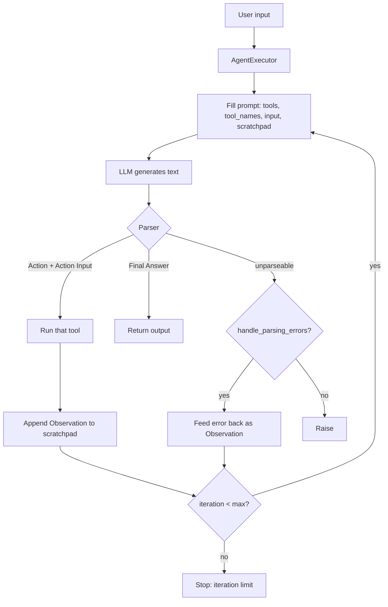

# AI agents

`tools-calling/` taught **one tool call** (or a `for` loop you wrote). This folder wraps that loop in a named object: an **agent**. The model **decides** the next action, a tool **runs**, the observation goes back, repeat until a **final answer**.

```text
chain     = you hardcode  A → B → C
RAG       = always retrieve, then generate
tool call = model asks for one function once
agent     = model may call tools 0..N times, in an order it chooses
```

`agent.py` is the **classic ReAct** agent (Thought / Action / Action Input as **text**). LangChain 1.x’s `create_agent` is the **tool-calling** agent (JSON `tool_calls`). Same job, different wire format. See `tools-calling/notes.md` for bind_tools.

Needs `CO_API_KEY` / `COHERE_API_KEY`, `ddgs`, `requests`. Run from the **repo root** with `venv312`. `load_dotenv()` must run **before** `ChatCohere`.

---

## What is an AI agent?

An **agent** is an LLM plus **tools**, a **policy** for when to use them, and a **loop** that stops when the task is done.

| Piece | Role |
| --- | --- |
| **Brain** | chat model (`ChatCohere`) |
| **Hands** | tools (search, weather, convert, retriever) |
| **Scratchpad** | past Thought/Action/Observation (or message history) |
| **Stop rule** | “Final Answer” / no more `tool_calls` / `max_iterations` |

Without tools it is just a chatbot. Without a loop it is just `bind_tools` once (`calling.py`). The agent is the **loop + the decision**.

### Agent vs the rest of this repo

| Pattern | Who chooses the next step? | Extra data |
| --- | --- | --- |
| LCEL chain | **you** (`prompt \| model \| parser`) | none |
| RAG chain | **you** (always retrieve `k` chunks) | vector store |
| Tool calling | **model**, **one** round unless you loop | live APIs |
| Agent | **model**, **many** rounds | tools + scratchpad |

`currency_converter.py` is already an agent: `for _ in range(6)` + two tools. `AgentExecutor` is that loop with parsing, verbose logs, and a max-step cap.

**One line:** an agent is a model that can **act**, **see the result**, and **act again**.

---

## Building an agent (four parts)

You always assemble the same four things. APIs change; this does not.

```text
1. LLM          ChatCohere / Gemini / local Qwen
2. Tools        list of BaseTool  (search, weather, …)
3. Prompt       ReAct template  OR  system prompt + bind_tools
4. Runner       AgentExecutor   OR  create_agent graph  OR  your for-loop
```

### 1. Pick a model that can follow a format

ReAct needs the model to emit **exact** labels (`Action:`, `Final Answer:`). Tool-calling needs native function calling. Tiny local models often break ReAct parsing; Cohere `command-a-03-2025` at `temperature=0` is the safer demo.

### 2. Give tools with good names and docstrings

The prompt injects `{tools}` (descriptions) and `{tool_names}` (allowed `Action:` values). If the weather tool’s docstring says “whether data”, the model will still try it — but search may win first. **Description = routing.**

### 3. Prompt = the policy

ReAct: “always Thought, then Action or Final Answer.”  
Tool-calling: “use tools when you need live data; otherwise answer.”

### 4. Runner = the lifecycle

- **Classic:** `create_react_agent` + `AgentExecutor`
- **Current:** `from langchain.agents import create_agent` then `invoke({"messages": ...})`
- **Hand-rolled:** the loop in `currency_converter.py`

---

## What is a ReAct agent?

**ReAct** = **Rea**son + **Act** ([paper](https://arxiv.org/abs/2210.03629)). The model does **not** emit a JSON tool call. It writes **text** in a fixed format; a **parser** turns that text into “run this tool” or “stop.”

```text
Thought: Antarctica might not have a capital. I should search.
Action: duckduckgo_search
Action Input: Does Antarctica have a capital city?

Observation: <search snippets come back here>

Thought: Confirmed — no capital. I cannot fetch weather for a city that does not exist.
Final Answer: Antarctica has no capital city, so there is no capital weather.
```

| Line | Meaning |
| --- | --- |
| **Thought** | private reasoning (the “Rea”) |
| **Action** | tool **name**, must be in `{tool_names}` |
| **Action Input** | string / args for that tool |
| **Observation** | tool result, written by the **executor**, not the model |
| **Final Answer** | stop; this is `output` |

The executor **stops the model** at `Observation:` (stop sequence) so it cannot fake the tool result. Then it runs the tool, appends Observation to `{agent_scratchpad}`, and calls the model again.

That is **not** the same as `bind_tools`:

| | ReAct (`create_react_agent`) | Tool calling (`create_agent` / `bind_tools`) |
| --- | --- | --- |
| Package (this venv) | `langchain_classic.agents` | `langchain.agents` |
| Model output | text: Thought / Action / … | `AIMessage.tool_calls` |
| Prompt | `{tools}` `{tool_names}` `{input}` `{agent_scratchpad}` | messages + tool schemas |
| Runner | `AgentExecutor` | LangGraph / your loop |
| Fragile bit | **parser** (one missing newline breaks it) | schema / injected args |
| Built for | completion LLMs | chat models with tools |

People say “ReAct” loosely for any reason→act loop. In this file it means the **text format**.

---

## Lifecycle (flowchart)

Happy path for `agent.py`:



Same loop as ASCII (what verbose logs print):

```text
                    ┌─────────────────────────────────────┐
                    │            AgentExecutor            │
  {input} ─────────►│  1. render prompt                   │
                    │  2. LLM → text                      │
                    │  3. parse                           │
                    │       ├─ Action ──► tool ──► obs ─┐ │
                    │       │                           │ │
                    │       └─ Final Answer ──► return  │ │
                    │                                   │ │
                    │  scratchpad ◄─────────────────────┘ │
                    │  stop if Final Answer or max_iter   │
                    └─────────────────────────────────────┘
```

**States in one table**

| State | Who | What |
| --- | --- | --- |
| Plan | LLM | Thought |
| Act | LLM | Action + Action Input |
| Execute | Python | `tool.invoke(...)` |
| Observe | Executor | Observation string in scratchpad |
| Finish | LLM | Final Answer |
| Guard | Executor | `max_iterations`, parse-error retry |

`create_react_agent` only builds the **runnable** “prompt → LLM → parse into Action or Finish.” `AgentExecutor` is the **while** loop around it.

---

## `agent.py` — what this file does

CampusX video 18 shape: search + a second API tool, ReAct prompt, executor, one `invoke`.

### Tools

```python
search_tool = DuckDuckGoSearchRun()          # built-in, invoke(query: str)

@tool
def get_whether_data(city: str) -> str:      # weather API JSON
    ...
```

Two tools in **both** `create_react_agent(..., tools=...)` and `AgentExecutor(..., tools=...)`. The list must match. Search is for “what is the capital”; weather is for live conditions. The Antarctica question often **never calls weather** — no capital city — which is a valid agent choice, not a bug.

Keep the weather **API key in `.env`**, not in the URL (same lesson as the FX key in `currency_converter.py`).

`DuckDuckGoSearchRun` still warns that `langchain-community` is sunsetting. Needs `pip install -U ddgs`.

### Prompt (local `hwchase17/react`)

Hub `pull("hwchase17/react")` is blocked unless you set LangSmith `dangerously_pull_public_prompt=True`. This file copies the template instead.

Required variables:

| Slot | Filled by |
| --- | --- |
| `{tools}` | rendered tool descriptions |
| `{tool_names}` | `duckduckgo_search, get_whether_data` |
| `{input}` | your question |
| `{agent_scratchpad}` | previous Thought/Action/Observation log |

Do not rename those keys.

### Model + agent + executor

```python
model = ChatCohere(model="command-a-03-2025", temperature=0)

agent = create_react_agent(llm=model, tools=[...], prompt=prompt)

agent_executor = AgentExecutor(
    agent=agent,
    tools=[...],
    verbose=True,                 # print Thought/Action/Observation
    handle_parsing_errors=True,   # bad ReAct text → retry, not crash
    max_iterations=8,             # same idea as range(6) in currency_converter
)
```

`create_react_agent` lives in **`langchain_classic`**, not `langchain.agents`. Current `langchain.agents` only exports `create_agent` (tool-calling graph).

`temperature=0` keeps Action lines stable. Verbose is easier with `python -u` (unbuffered) so you see the chain while Cohere thinks.

### Invoke

```python
agent_executor.invoke({
    "input": "find the capital of Antarctica and find its whether condition"
})
```

Input key is **`input`**, not `messages`. Output dict has `input` and `output` (the Final Answer string).

A real run looked like: search “Does Antarctica have a capital?” → Observation snippets → Final Answer: no capital, so no weather. Search ran **twice** on a messy first parse; `handle_parsing_errors` absorbed the junk `O` after Action Input.

---

## Gotchas this file already hit

| Symptom | Cause |
| --- | --- |
| `cannot import name 'create_react_agent' from 'langchain.agents'` | LangChain 1.x moved it to `langchain_classic` |
| `cannot import name 'hub' from 'langchain'` | Hub is not in the 1.x package |
| `cannot import name 'pull' from 'langchainhub'` | use `langchain_classic.hub` or `Client().pull_prompt` |
| public prompt pull `ValueError` | need `dangerously_pull_public_prompt=True` **or** a local template |
| `CO_API_KEY` ApiError | `load_dotenv()` missing / after `ChatCohere` |
| Hang with no verbose text | stdout buffered; `python -u` |
| `IndexError` / parse errors | Cohere drifts off ReAct format → `handle_parsing_errors` |
| Infinite Thought/Action | cap with `max_iterations` |

---

## When to use ReAct vs `create_agent`

| Use ReAct (`agent.py`) | Use tool calling (`create_agent` / `currency_converter.py`) |
| --- | --- |
| Course / paper format | Cohere, OpenAI, Gemini production |
| Model has **no** native tools | Model has `bind_tools` |
| You want to **read** the thoughts in logs | You want reliable JSON args |

Next on the CampusX / 2026 roadmap: **LangGraph** (state, nodes, edges) then **CRAG / Self-RAG**. That is `create_agent`’s world, not `AgentExecutor`.

---

## Mental model

```text
Chain     = recipe you wrote
RAG       = open the right page, then write
Tool      = one phone call
Agent     = intern with a phone: think, call, read, think again, stop
ReAct     = intern must write the call on a paper form
Tool-call = intern taps a structured button
```

---

## Run

```powershell
python -u .\agents\agent.py
```
